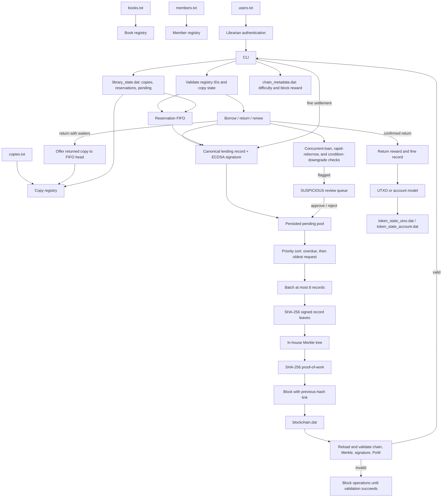

# System Design



## Data model and integrity

Each block has an index, Unix timestamp, fixed record count, previous block hash, Merkle root, sealing identity, aggregate return reward, reward transaction ID, proof-of-work difficulty and nonce, and final hash. A block contains at most eight `LendingRecord` values. A record stores its SHA-256-derived ID, book/copy/member identifiers, title and member-name snapshots, action, due date, fine, per-member nonce, return reward, reason code where applicable, and ECDSA signature.

New ordinary member records are signed with per-member P-256 keys; private keys live in `member_<ID>_key.pem` and matching public-key PEM files are written to `member_<ID>_public.pem`. The member ID in a record selects its public-key identity for verification. Librarian-authenticated lost-copy and condition overrides use `signing_key.pem`. Legacy records signed by the librarian key are accepted for migration compatibility. The canonical signed payload is separate from the signature itself. The record leaf hash includes both canonical fields and the signature. Merkle construction starts with record leaf hashes, hashes adjacent pairs at each level, duplicates the last hash for an odd-sized level, and continues until one root remains. The block hash covers its header, Merkle root, and all record leaf hashes. Chain validation checks each record ID and signature, referential integrity against loaded registries, each recomputed Merkle root, the block hash and proof-of-work prefix, strict timestamp order, and previous-hash continuity.

The binary `blockchain.dat` format is versioned by a nine-byte magic string followed by the block count and fixed-layout block entries. `LIBCHAIN1`, `LIBCHAIN2`, and `LIBCHAIN3` ledgers are migrated to current `LIBCHAIN4` at startup; version-3 records are re-signed with the action-bound payload and blocks are re-mined. `library_state.dat` stores the mutable copy inventory, reservations, and signed pending requests; at startup, copy states are cross-checked against the latest confirmed and pending lending records. The `validate` command reloads the chain from disk and verifies the full chain before replacing the in-memory copy; after a failed validation, other CLI commands are blocked until a successful validation. Token state is stored separately per model in a versioned binary snapshot bound to the chain count and tip hash, restoring balances, account nonces, histories, or UTXOs. A separate `chain_metadata.dat` file persists the active difficulty and fixed block reward. Files are written through temporary files and rename.

## Lending, copies, and reservations

`books.txt`, `members.txt`, and `copies.txt` must all be present and non-empty. The copy registry is keyed by `copy_id` and associates each copy with a valid `book_id`, condition, availability state, holder, due date, and renewal count.

The copy state machine permits available copies to be borrowed, borrowed copies to be returned to availability or offered as reserved, and available or borrowed copies to be marked lost with a reason code. Copy selection can be explicit or automatic. The borrower/member pair is checked on return and renewal. Loan and renewal periods are 14 days; renewals are limited to two and rejected when another member is waiting.

Reservations are stored FIFO per title with a creation timestamp. Reservation is accepted only when all copies are unavailable. A returned copy is offered to the oldest waiting member before it becomes generally available. The holder of that offer can borrow the reserved copy. Overdue scanning runs at startup and on the `overdue` command, reports per-day fines, and queues one overdue record per loan due date rather than duplicating it on every scan.

Lending actions are signed and persisted in the pending pool before mining. Mining sorts overdue/fine-related records first, then by request time, and packs up to eight records into a block. Per-member nonces are assigned in block-confirmation order and signed before the block is mined. Return rewards are 10 coins when returned by the due date and 5 coins when late; late returns and overdue records carry a fine of one coin per day.

`settle_fine MEMBER_ID COPY_ID AMOUNT` creates a signed `FINEPAID` event for a recorded fine period. Fine reports group overdue and late-return assessments for one loan by copy and due date, use the greatest assessment to avoid double-counting, and deduct confirmed and pending payments. The settlement itself remains pending until mined.

Borrow requests are held as suspicious when the member already holds the configured maximum of five copies or has a confirmed return of the same title within 24 hours. A condition update that downgrades more than one level without a reason beginning `OVERRIDE:` is also held for review; condition changes are signed with the librarian key. Reviewers can inspect the queue and explicitly approve or reject a suspicious request; mining excludes suspicious status. The current detector does not claim to catch every duplicate semantic request.

## CLI flows

```text
borrow BOOK_ID MEMBER_ID [COPY_ID]
return BOOK_ID MEMBER_ID [COPY_ID]
reserve BOOK_ID MEMBER_ID
renew COPY_ID MEMBER_ID
overdue [COPY_ID]
copies | copy COPY_ID | reservations | view_book BOOK_ID
pending
mine solo MEMBER | mine pool MINER1 MINER2 [MINER3 [MINER4]]
mine cloud ROUNDS MEMBER
fraud_review | approve_suspicious ID | reject_suspicious ID
view | validate | tamper
```

`tamper` validates a deliberately altered temporary copy of the chain and leaves the persisted ledger unchanged.

`add_copy COPY_ID BOOK_ID CONDITION` adds a runtime copy, and
`mark_lost COPY_ID MEMBER_ID REASON_CODE` records a librarian-authorized loss.
`set_condition COPY_ID MEMBER_ID NEW|GOOD|WORN REASON_CODE` queues a librarian-
authorized condition change.
`settle_fine MEMBER_ID COPY_ID AMOUNT` queues a signed fine settlement.
The CLI continues to provide token-model selection, balance/UTXO display, token
transfers, transaction history, and solo/pool/cloud mining demonstrations.
Token transfers are signed and queued; the token ledger is updated only after
their `TRANSFER` records are confirmed by mining. `settle_fine` follows the same
pending-record and confirmation path.

Mining rewards are paid to explicitly selected registered member IDs. Solo mode
credits the chosen member the fixed reward per block. Pool mode assigns measured
hash-attempt contributions across two to four selected miners after the 2% fee.
Fractional shares are saved per member until they accrue to a whole coin. Cloud
mode credits gross rewards for the requested rounds and reports rental and
maintenance expenses in its net-profit summary; those simulated operating costs
are not debited from the token ledger.

## Ledger assumptions

- Default difficulty is two leading hexadecimal zeroes; allowed command-line values are one through four. The setting and fixed block reward are stored in `chain_metadata.dat`, and `set_difficulty` updates the saved difficulty.
- Confirmed return rewards and model-matched mined transfers are replayed from the chain when initializing a token model.
- A one-token transaction fee is deducted from member returns; the UTXO and account models share the confirmed reward history.
- Mined transfers and linked-list history are serialized with the selected token model. The snapshot is rejected if corrupt or if its stored chain tip does not match the loaded chain.
- Mining payouts, fractional pool shares, and history are serialized in the same model-specific token snapshot. Payout recipients and pool contribution details are not committed in the block itself, so restoring a missing token snapshot cannot reconstruct these mining payouts from the chain alone.
- This is an educational single-node simulation, not a distributed consensus network. A production deployment would require per-member key custody, authenticated key registration, replicated state, and a formally specified transaction protocol.
